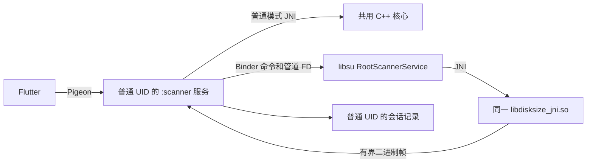

# 阶段 4：Root 后端与验收

日期：2026-11-15

## 实现范围

应用已接入固定版本 `com.github.topjohnwu.libsu:service:6.0.0`。JitPack 仓库仅允许 libsu 所属 group，普通启动和查询授权状态不会执行 `su`。点击“请求 root 访问”后才初始化 root shell、绑定服务，并检查 JNI 返回的 UID、有效 UID、PID 和自检结果。拒绝授权显示重试指引，普通模式继续可用。

`RootScannerService` 采用非 daemon 模式，校验每次 Binder 调用的 UID，只接受当前开发应用的调用。扫描在独立工作线程执行，Binder 只传命令、会话 UUID、客户端存活 token 和 pipe FD。进度、节点批次、问题记录和最终汇总由 native 直接写入管道，不调用 `find`、`du` 或 shell 文本解析实现扫描。

普通 `CoordinatorService` 继续独占前台服务、通知、状态机和 `AtomicFile` 会话记录。root 进程没有数据库、缓存或导出的写入入口。扫描开始即记录实际 root UID/PID 和 root 视图，结束后附加实际根挂载 ID；完成状态仍须先持久化，再向 UI 公布。完整 SQLite 索引、缓存和导出功能尚在后续阶段，届时也须沿用普通 UID 的写入边界。

## 授权、挂载与用户范围

- 授权状态为 `not-requested`、`requesting`、`ready`、`unavailable`。拒绝后关闭非 root 的缓存 shell，允许再次显式请求。libsu shell 初始化使用其 20 秒默认时限，服务绑定另设 25 秒时限。
- root 身份必须同时满足实际 UID 和有效 UID 为 0；管道首帧再次核对 native 身份及已绑定 PID。
- 在普通 coordinator 进程中、创建 libsu 主 shell 之前配置 `FLAG_MOUNT_MASTER`；仍仅在显式请求 root 时运行 su。不使用 daemon 或 `setenforce`。优先通过 `su --mount-master` 启动服务，避免继承应用数据隔离的 tmpfs 视图；su 不支持该选项时 libsu 会回退，最终仍读取实际 root 进程的 `/proc/self/mountinfo`、`/proc/self/ns/mnt` 和 SELinux 上下文。问题复现与设备回归见[Root 挂载视图修复](./root-mount-namespace.md)。
- 候选入口包括 `/data`、当前用户的 CE/DE 应用目录、`/data/media/<user>` 和 `/storage/emulated/<user>`。每项显示可打开状态、挂载 ID、文件系统和共享存储别名组；root 路径的最终解析由 root native 完成，普通服务不替它规范化路径。
- 切换 root 模式默认仍指向应用自身目录。选择 `/data` 是显式扩大到整卷，会包含所选挂载上可访问的其他用户目录；界面对此作出说明。其他用户和工作资料没有自动扫描入口，可通过显式路径选择范围。
- 通过普通客户端 UID 推导 Android 用户，列出 `/data/user` 下可见的数字目录，并查询当前上下文的 `UserManager.isUserUnlocked`；无法确认时显示“未知”。可打开目录不代表全部加密内容已经解锁，也不尝试绕过 fscrypt。
- `/data/media/<user>` 与 emulated 路径标记为同一共享数据候选；每次只扫描一个入口，默认不跨挂载，避免两者重复累计。FUSE 和底层文件系统的报告占用量可能不同。

## 二进制协议 v1

此节记录阶段 4 的协议。阶段 5 的应用扫描已升级为增量 metadata v2，阶段 6 升至带卷采样的 v3；普通/root 共用接收端并写入 SQLite，v1 仅保留作原型回归。当前行为见[阶段 6 文档](./phase6-explorer.md)。

整数采用大端序，帧头固定 36 字节。所有帧均校验 magic、版本、会话 UUID、连续序号和长度。单帧 payload 最大 65,536 字节；长度不合法时拒绝分配和解析。

| 帧头字段 | 字节数 |
| --- | ---: |
| Magic `0x44535a34`（`DSZ4`） | 4 |
| 协议版本 `1` | 2 |
| 类型 | 2 |
| Payload 长度 | 4 |
| 会话 UUID 原始字节 | 16 |
| 从 0 开始的连续序号 | 8 |

| 类型 | 内容 |
| --- | --- |
| 1 Identity | native UID、有效 UID、PID，各为 u32 |
| 2 Progress | 节点数、暂定逻辑大小、问题数、耗时，各为 u64 |
| 3 Nodes | u32 条数；每节点含 u64 ID/父 ID、u32 长度与原始名称、类型/完整性/跳过标志、最终子树逻辑大小及占用量 |
| 4 Issue | 节点 ID、错误码、errno、带长度的操作名、路径是否可预览、带长度的原始相对路径 |
| 5 Summary | 最终状态、完整性、节点和容量总量、问题/丢弃数、FD 指标、实际根挂载 ID、文件系统类型、已传问题数；固定 84 字节 |
| 6 End | 空 payload；此后必须为 EOF |

Identity 必须在最前；进度在最终节点前；节点按连续 ID 输出且父 ID 小于子 ID；Summary 只允许一次，节点/问题数必须与已收记录一致。短帧、缺少 End、尾随字节、异常枚举、超长名称、非法父子关系或会话串流均不接受。读端只有收到合法 Summary、End 和 EOF 后才返回最终结果；管道 EOF 本身不代表完成。

名称以原始字节传输，不以换行、空格或 UTF-8 分割。ordinary 读端只保留最多 64 条预览和 64 条问题，原始路径以 `pathHex` 进入有界会话记录。UI 显示时替换无效 UTF-8，并转义换行、回车和制表符；原始字节仍可还原。预览相对路径上限 4,096 字节，路径总 hex 预算每类 64 KiB；超出范围显示截断，不改变容量统计。

本阶段在遍历期间传输进度，扫描完成聚合后再分批发送节点。Android 上限仍为 100,000 节点，C++ 仍持有 O(N) 结果；普通服务消费未进入预览的记录后丢弃。当前节点帧只承载阶段 4 所需字段，阶段 5 接入完整节点元数据和数据库导入时须显式升级协议。

## 取消、死亡与资源

- Binder 取消按 UUID 匹配，转发同一 native cancellation token。开始前取消不会派发新的 root 扫描。
- 写端复制并拥有独立 FD，使用非阻塞写入与 100 毫秒 poll。进度传输在背压下检查取消；管道断开立即失败，最终传输遇到持续不消费时在 10 秒无写入进展后失败，避免无限等待。
- root 退出会产生 Binder 断开及 pipe EOF，当前扫描持久化为 `interrupted`，随后可重新显式请求授权。没有有效结束帧时保留已知进度，不伪造完整统计。
- root 服务监听普通客户端 Binder 的死亡；libsu 非 daemon 服务也随客户端进程消失而退出。正常解绑和服务销毁时取消任务，释放 native handle、两端 FD 和 death recipient。
- 普通服务死亡后沿用阶段 3 的 active marker 恢复为 `interrupted/process-interrupted`，新服务的 root 状态回到未请求。
- libsu 6.0.0 会在遍历连接表时同步发出断开回调。实测发现回调内再次 `unbind` 会触发其 `ArrayMap` 迭代异常；本实现让库完成断开清理，不在该回调内重入解绑。真实杀进程后重连已覆盖这一行为。

## 验收记录

设备沿用阶段 0：Xiaomi sheng，Android 16/API 36，KernelSU 3.3.0，arm64、4 KiB 页、F2FS/FUSE，SELinux 保持 Enforcing。应用普通 UID 在测试重装后会变化；最新通过的运行中，普通 UID 为 10370，实际 root 进程 PID 为 25092，UID/有效 UID 均为 0。

| 验证 | 结果 |
| --- | --- |
| 显式授权和拒绝 | 未请求时 root 扫描被拒绝；KernelSU 拒绝 su 后状态可恢复；仅为开发包授权后重试成功，普通模式独立可用 |
| 受保护原始名称样本 | 11 节点，逻辑大小 1,073,741,856 字节，报告占用 27,648 字节；中文、空格、换行及 `ff` 字节名称完整传回 |
| 阶段 0 基线 | 169 节点，逻辑大小 1,073,746,077 字节，报告占用 660,480 字节，与已有独立 stat 基线一致 |
| 共享存储映射 | 底层和 FUSE 入口分别得到 4 节点、4,105 字节；根挂载 ID 分别为 17042/17057，仅核对同一数据，不合并重复累计 |
| 缺失根目录 | root 返回 Failed/not-found，未被运输错误覆盖 |
| 只读与所有权 | 扫描前后独立 stat 元数据一致；应用私有样本内容、UID/GID/模式不变；会话记录由普通应用 UID 写入 |
| 取消 | 实际开始后取消，Cancelled、complete=false、native 打开 FD 归零 |
| root 进程死亡 | 杀死经 UID/cmdline 双重核验的 root PID，普通服务存活，Interrupted 后可重新授权并扫描 |
| 普通客户端死亡 | 杀死普通 coordinator，确认旧 root PID 消失；恢复中断记录，再显式绑定成功 |
| 普通模式生命周期回归 | 3 项真机集成测试通过，含 Partial、取消、服务死亡/持久恢复、真实前后台切换、共享存储及 dataSync 超时 |
| 管道异常 | arm64 原生测试覆盖读端断开、背压时取消、最终结果消费者停读的 10 秒时限，3 组通过 |
| 协议解析 | 4 项 JVM 测试覆盖正常原始字节及多种短帧、版本/长度/会话/身份/序号/记录错误 |
| 回归 | 10 项 Flutter 测试、8 组原生扫描测试通过；Android 双 ABI 构建通过；Lint 0 错误、6 项提示（含实际 root 路径和固定测试依赖版本提示） |

当前证据来自这一台 KernelSU/API 36 设备；Magisk、其他 su 实现、真实锁定用户/工作资料、x86_64 运行及 16 KiB 页设备仍需后续矩阵验证。完整索引、分页和大规模内存表现留在阶段 5，不能从本阶段的有界预览推断已经完成。

最终正常入口 debug APK 已构建并安装，包含 arm64-v8a/x86_64 的同一扫描库，SHA-256 为 `53097E19EBC4E73EDC02C5A0C7D410E26BD4FD378653DBD00C4DBA1AFDB28954`。测试结束后恢复所有文件 AppOp 为 `default`、dataSync 自定义时限为未设置，SELinux 为 Enforcing；本阶段临时样本已删除，没有遗留 root 工作进程。最终应用以普通模式启动，root 授权保持显式请求。

复现命令、主机授权驱动适用范围及日志见[阶段 4 工具说明](../tools/phase4/README.md)。

参考：[libsu 6.0.0](https://github.com/topjohnwu/libsu/tree/6.0.0)、[RootService 接口](https://topjohnwu.github.io/libsu/com/topjohnwu/superuser/ipc/RootService.html)。
