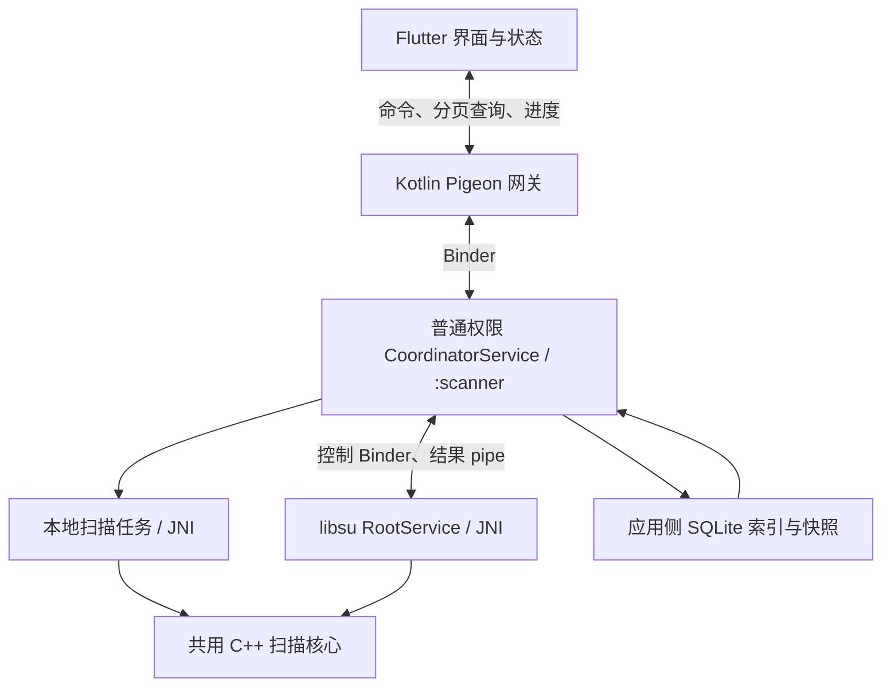

# DiskSize 第一版实现方案

日期：2026-11-15

状态：设计基线；阶段 0～4 已完成，普通/root 后端、Android 生命周期与有界传输已接入，完整索引待阶段 5

## 1. 目标与首版范围

面向开发者提供类似 TreeSize 的 Android 存储分析体验：回答“空间用在哪里”“哪些目录最大”“两次扫描之间哪里增长了”。root 是可选能力，普通模式应独立可用。

首版包含：

1. 存储卷与扫描入口选择，展示当前权限和可访问范围。
2. 应用自身目录、普通权限可访问目录、所有文件访问模式及 root 模式的真实路径扫描。
3. 目录树、按大小排序、当前目录的大文件列表、文件和目录详情。
4. 可下钻的矩形树图，区分文件逻辑大小与文件系统报告的占用量。
5. 扫描进度、取消、失败与跳过记录、部分扫描结果。
6. 本地快照及同一扫描范围内的两次快照对比，展示新增、删除和增长最多的路径。

首版不包含文件删除、自动清理、重复内容查找、文件内容哈希、持续全盘监控和云端同步。开发缓存识别、按应用归属汇总及 Shizuku 后端列入后续版本。

SAF/DocumentProvider 可能提供云端或虚拟文件，不保证存在可交给 C++ 的文件路径。首版不将内容 URI 转换成所谓真实路径；后续单独实现 SAF 扫描后端。

## 2. 技术选型与本机工具链

| 项目 | 选型或已确认状态 |
| --- | --- |
| UI | Flutter 3.47.9 stable，Dart 3.13.7 |
| Flutter 路径 | `E:\Projects\.toolchains\flutter` |
| Android SDK | `I:\Software\Android\SDK` |
| 已装平台 | API 36 revision 2、API 37.0，Build Tools 36.0.0 |
| 首版 compileSdk / targetSdk | 先沿用已检查的 Flutter 模板值 36，API 36 平台已安装；发布前复核平台要求 |
| minSdk | 建议 29，覆盖 Android 10；通过独立兼容分支处理 API 29 的存储权限 |
| JDK | 已有 `D:\Software Environment\jdk-21.0.9`，作为首版构建 JDK |
| NDK | 固定 `28.2.13676358`，与当前 Flutter 模板默认值一致；已安装并通过交叉编译验证 |
| CMake | 首版固定 `3.22.1`；已安装并通过构建验证 |
| 扫描核心 | C++20、NDK、CMake |
| Android 接入 | Kotlin、Pigeon、JNI、Binder/AIDL |
| root 接入 | libsu RootService，阶段 4 已验证并锁定 6.0.0 |
| 本地索引 | SQLite，普通应用权限下管理 |
| ABI | 首版 arm64-v8a 真机和 x86_64 模拟器 |

使用 Flutter 模板兼容的 Gradle、AGP 和 Kotlin 组合，生成项目后将实际版本固定在仓库中。不得硬编码 4096 字节内存页大小；验证 Flutter 引擎、第三方库和自编译库在 16 KB 页设备上的兼容性。

上述绝对路径属于本机环境信息，不写入可提交的 Gradle 构建逻辑。SDK 路径通过环境变量或忽略提交的 `android/local.properties` 指定。

完整工具版本、普通应用和 root 设备验证及测试数据见[阶段 0 环境基线](./environment-baseline.md)。

## 3. 总体架构

### 3.1 Flutter

- 管理页面、选择状态、排序与展示，不负责全盘递归和全量目录聚合。
- 通过 Pigeon 发送开始、取消、查询子目录、查询详情和快照对比请求。
- 目录列表分页加载，树图只布局当前可见范围，避免把百万节点转换成 Dart 对象。
- 使用 `CustomPainter` 绘制矩形树图；支持下钻、返回、节点聚合和命中检测。

### 3.2 Kotlin 与普通扫描服务

- Pigeon 网关负责 Flutter 与 Android 类型转换。
- `CoordinatorService` 位于普通应用权限的 `:scanner` 进程，负责会话、后台任务、结果接收和索引读写；不使用 `isolatedProcess=true`。
- Binder 调用立即返回会话或任务标识，实际扫描和数据库工作运行在工作线程。
- 普通模式在该进程通过 JNI 调用 C++。root 模式绑定 RootService，由独立 root 进程调用同一份 C++ 库。
- 服务处理客户端消失、root 服务死亡、取消、超时和资源关闭。长扫描按目标 Android 版本使用适当的前台服务类型与通知。
- 所有 Android 组件默认不导出；root 控制接口校验调用方身份，只接受约定的扫描命令。

### 3.3 C++ 核心

- 核心不依赖 Flutter，不调用 `su`，不决定 Android 权限申请策略。
- 使用 `readdir`、`openat`、`fstatat` 等文件系统接口；默认不跟随符号链接。
- 输出紧凑节点、计数和错误；通过统一的任务、取消令牌与批量结果接口供普通和 root 后端复用。
- 单独分离路径遍历、统计聚合和查询模块，方便使用合成文件树验证。

### 3.4 root 与数据传输

Flutter 进程内的 FFI 库继承应用 UID，不能自行获得 root。root 扫描通过 libsu RootService 加载原生库执行，普通 UI 保持应用权限。

Binder 传递控制信息、会话状态和文件描述符；扫描节点通过带长度和版本的二进制 pipe 分批传输。协议包含会话 ID、序号、记录类型及完成标识，并限制单条记录和单批数据长度。文件名不能用换行或空格分隔。

数据库及快照由普通应用进程创建和维护。root 进程只读取目标文件系统并输出结果，不直接创建应用数据库，避免所有权与多进程写入问题。进程间状态全部显式传递，不能依赖 C++ 静态对象共享。

## 4. 权限与可访问范围

| 模式 | 行为 |
| --- | --- |
| 自身目录 | 无额外存储权限即可扫描自身可访问路径 |
| Android 10 共享存储 | 根据 API 29 行为处理 `READ_EXTERNAL_STORAGE` 和适用的 legacy storage 配置；不申请写入权限 |
| Android 11+ 所有文件访问 | 显式引导用户开启 `MANAGE_EXTERNAL_STORAGE`，通过实际访问验证能力 |
| root | 用户授权后检测 root UID、目标路径访问和挂载视图；拒绝或失败时允许切换普通模式 |

所有文件访问不等于访问所有应用数据：其他应用的私有目录和 `Android/data` 等仍存在限制。root 模式同样可能受 SELinux、挂载命名空间、多用户、工作资料及文件加密状态影响，不通过关闭 SELinux 提升可访问性。

扫描入口在扫描进程内解析实际挂载信息，并明确记录用户、卷和访问模式。默认不访问其他用户或工作资料；切换这类扫描范围必须由用户显式选择。

通知授权与存储授权分别处理。扫描由用户在前台启动；不能因为通知权限被拒绝就把可访问目录误判为无权限。长任务遵守所选前台服务类型的启动、时限和停止要求。

## 5. 扫描及空间统计规则

### 5.1 数值含义

- **逻辑大小**：普通文件的 `st_size`；目录自身的 `st_size` 不作为文件内容容量累计。
- **报告占用量**：文件系统返回的 `st_blocks × 512`，包含适用的目录和链接自身分配量。512 是该字段单位，不是 `st_blksize` 或设备内存页大小。
- **卷已用量**：通过同一扫描进程可见的卷统计获取，并记录统计时间。
- **未归因空间**：卷已用量与已归因扫描量之间的差额，仅在范围和视图可比较时展示；差额为负时展示不一致状态，不强制修正为零。

报告占用量不保证等于真实物理空间。压缩、共享块、FUSE、文件系统元数据、已删除但仍打开的文件、权限不足以及扫描期间变化，都可能造成统计差异。

### 5.2 去重与边界

- 默认不跟随符号链接，显示链接属性和目标文本，不扫描目标内容。
- 在同一扫描视图中通过 `(st_dev, st_ino)` 识别硬链接；保留每个目录项的原始大小。
- 最终聚合时，对同一文件使用扫描根内按原始路径字节排序最小的路径作为计入节点，其余标记为共享链接。逻辑大小和报告占用量均按该规则去重，目录详情展示共享关系。
- 进度中的聚合数值可以是暂定值；完成去重后的最终汇总才写入完成快照。
- 硬链接去重不能识别 reflink 等共享数据块，不承诺精确分摊这些物理块。
- 按选定卷扫描，默认不跨挂载点；通过挂载视图识别 bind mount 等别名，不能仅凭 `st_dev` 判断所有边界。
- 对共享存储及其底层映射选择一个扫描入口，避免重复累计 `/storage/emulated/0` 和 `/data/media/0`。
- 默认排除 `/proc`、`/sys`、`/dev` 等伪文件系统；特殊设备、FIFO 和 socket 只记录类型，不读取内容。
- 使用显式任务队列控制目录遍历、深度和同时打开的文件描述符数量，避免深目录耗尽线程栈或 FD。

### 5.3 并发、错误与一致性

从两个遍历工作线程起步，队列有界，性能测量后再调整。扫描通过元数据获取大小，不打开普通文件读取内容。

阶段 2 已实现独立 C++ 原型和 CLI，详细接口与验收见[扫描核心文档](./phase2-scanner.md)。原型当前只支持单挂载且不跟随发现项符号链接，其他策略明确返回 Unsupported；节点和最终聚合暂留 C++ 内存，持久化与规模验证在阶段 5 完成。

阶段 3 已接入普通应用 UID 的服务扫描、dataSync 前台服务、API 29/API 30+ 权限分支和有界会话记录，见[普通模式与生命周期](./phase3-ordinary-lifecycle.md)。当前状态/预览记录与阶段 5 的完整 SQLite 节点索引是不同层次；Android 入口暂限 100,000 节点。

阶段 4 已接入显式 root 授权、libsu 6.0.0 RootService、同库 JNI、带会话/序号/结束标识的有界二进制管道及死亡恢复，见[Root 后端与验收](./phase4-root-backend.md)。节点在 native 完成聚合后分批传输；完整索引导入和规模验证留在阶段 5。

区分无权限、文件已消失、I/O 错误、主动跳过和取消。不可访问目录使用“未知/未完成”状态，不能计为已确认的零字节。扫描期间发生的修改不构成原子文件系统快照，界面展示开始时间、结束时间和完整性状态。

进度按约 100～250 ms 合并更新，包含已处理条目、已累计容量、耗时和错误数。发现阶段没有可信总数时，不展示虚构百分比。取消定期检查；阻塞的内核 I/O 可能延迟取消，UI 先显示“正在停止”。

## 6. 数据设计与查询

SQLite 使用单一写入端、事务批次及明确的 schema 版本，实际性能和空间占用在原型阶段验证。

| 实体 | 主要字段 |
| --- | --- |
| ScanSession | ID、卷与根路径、访问模式、用户、挂载标识、策略版本、状态、起止时间、错误计数 |
| Node | 会话 ID、节点 ID、父节点 ID、原始名称、类型、设备号与 inode、UID/GID、原始大小、报告占用量、时间戳、错误标志 |
| Aggregate | 节点 ID、去重后逻辑总量、占用总量、文件与目录计数、完整性、统计归属 |
| ScanIssue | 会话 ID、节点或路径、错误码、错误类别、发生阶段 |
| Snapshot | 会话引用、统计规则版本、完成状态、创建时间 |
| Diff | 基于两个快照查询或计算的路径变化及容量差额 |

名称保留原始字节，显示层处理无法正常解码的名称；完整路径按父节点关系重建，避免为每个节点复制长路径。需要时为排序建立索引，不在 Flutter 中全量排序。

SQLite 的扫描索引和 C++ 聚合是权威数据来源。Dart 只缓存当前页面的数据。所有容量与计数跨 JNI、Binder 和 Pigeon 时使用可容纳 64 位整数的类型。

首版查询至少包含：`listChildren`、`getNodeDetails`、`getLargestFiles`、`getScanIssues`、`listSnapshots`、`compareSnapshots`。列表分页使用稳定排序和节点 ID 作为并列键。

快照比较先验证卷、用户、根路径、去重策略和统计规则是否兼容。部分扫描只能显示已知变化，并明确标记不可比较范围。首版按相对路径比较，重命名显示为删除和新增，不宣称识别真实移动。

## 7. UI 与产品行为

1. 首页展示卷、访问模式、权限状态和最近快照。
2. 扫描页提供状态、已处理条目、耗时、错误计数和取消操作。
3. 目录页提供面包屑、排序、逻辑大小/占用量切换与分页列表。
4. 矩形树图只布局当前目录或限定深度，按像素阈值聚合小项；颜色和面积含义保持一致。
5. 详情页显示路径、元数据、共享链接及权限错误，路径支持复制。
6. 对比页展示新增、删除、大小变化及增长最多的路径，明确快照完整性。

## 8. 验证基线

- 功能样例：空目录、Unicode/空格/换行名称、深目录、大文件、稀疏文件、硬链接、符号链接循环、权限拒绝和文件并发变化。
- 规模样例：逐级测量约 1 万、10 万和 100 万条目；记录扫描、索引和首屏查询各自的耗时、RSS/PSS、数据库大小和取消延迟。
- 权限样例：无额外权限、所有文件访问开启/关闭、root 拒绝/root 可用、root 服务中途退出。
- 平台样例：API 29 分支、API 30+ 存储限制、当前目标 API 的后台规则、4 KB 和 16 KB 页环境。
- 参照工具：在同一挂载视图、同一权限、同一去重和大小口径下与设备 `du` 等结果核对，记录其实现和选项；不能跨视图直接比较。

准确性样例必须通过后才进入性能优化。性能阈值由原型在固定测试设备上测量并写入基线，不能仅以“C++ 更快”作为结论。

## 9. 参考

- [Android 所有文件访问](https://developer.android.com/training/data-storage/manage-all-files)
- [StorageStatsManager](https://developer.android.com/reference/android/app/usage/StorageStatsManager)
- [Android 16 KB 页大小支持](https://developer.android.com/guide/practices/page-sizes)
- [libsu 与 RootService](https://github.com/topjohnwu/libsu)
- [Android 前台服务类型](https://developer.android.com/develop/background-work/services/fgs/service-types)
